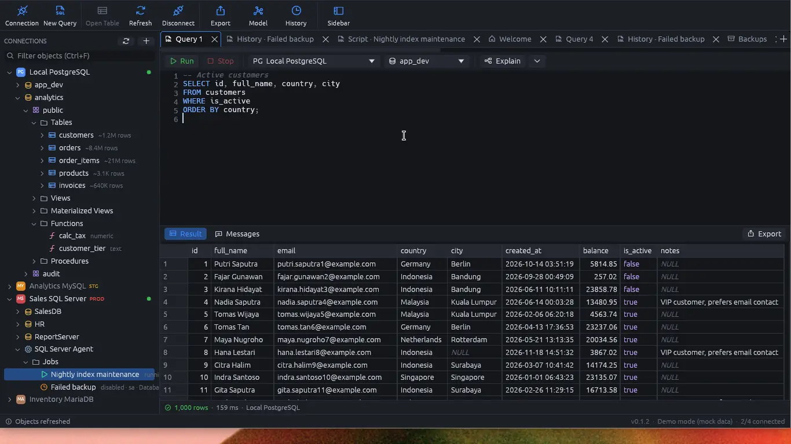
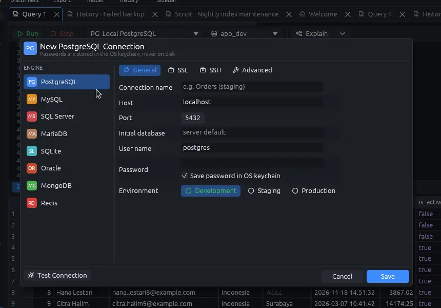
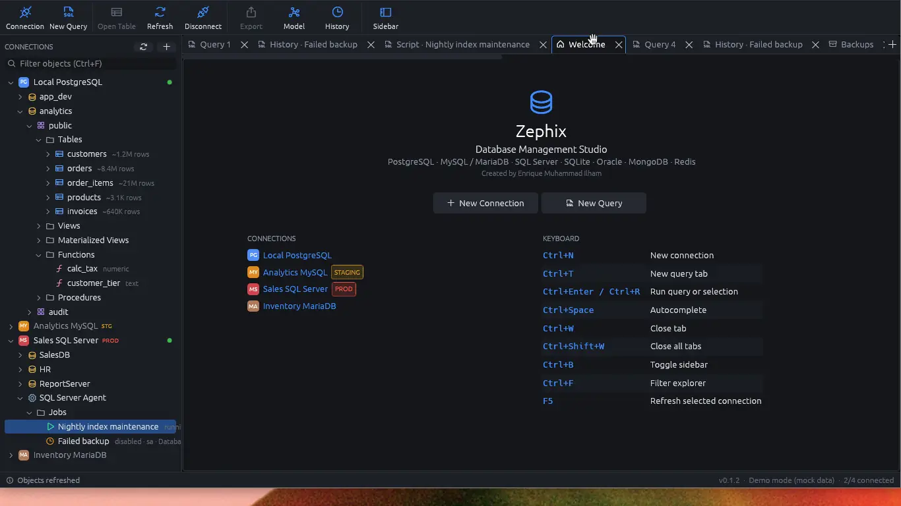
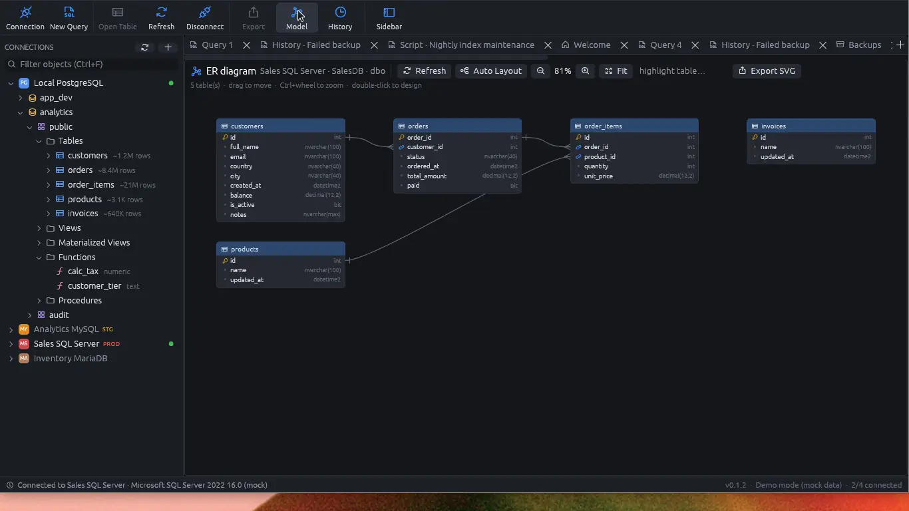
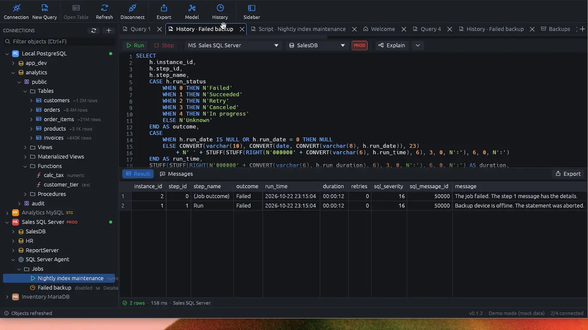
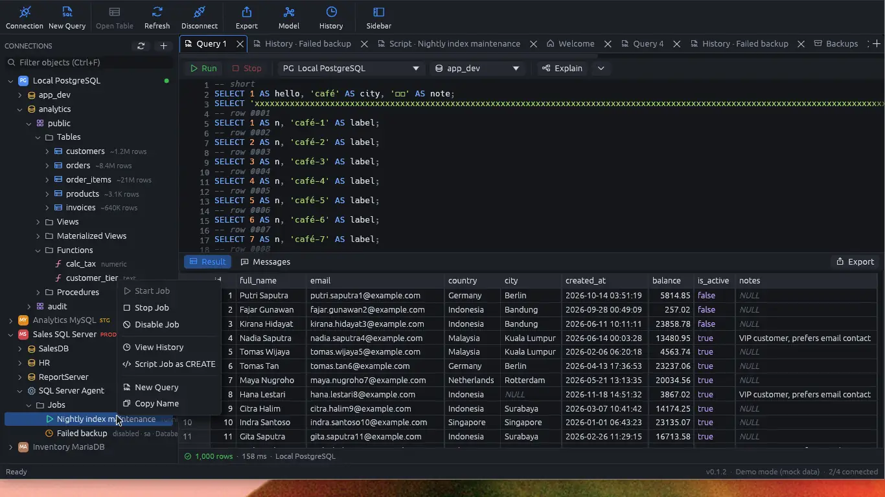

# Zephix

Native desktop database IDE for PostgreSQL, MySQL, MariaDB, SQL Server, SQLite, Oracle, MongoDB,
and Redis. Written in Rust (egui). One executable on Windows, macOS, and Linux.

[](https://github.com/EnriqueMuhammad/Zephix-DBStudio/actions/workflows/ci.yml)



The screenshots in this README are from `zephix --demo`. That mode uses a built-in sample engine
and sample connections. Nothing is saved, and the names you see (hosts, databases, people) are
fake demo data.

## Features

- **Connections.** Saved profiles, TLS modes, SSH tunnels (password or key, with a host-key
  check), and passwords in the OS keychain (Windows Credential Manager, macOS Keychain, Linux
  Secret Service) or asked once per run. Writes on a production connection ask for confirmation.
- **Query editor.** Syntax highlighting, autocomplete, run the script or only the selection,
  multiple result sets, stop a running query, query history, and explain / explain analyze.
  Scripts open from and save to `.sql` files; unsaved changes are asked about before a tab or
  Zephix closes. Brackets and quotes close as you type, `begin` offers a transaction template,
  and an Advanced menu has word wrap, view white space, case, line moves, sort, comment and
  indent commands. Messages show the rows affected by each statement.
  MongoDB uses shell syntax. Redis uses redis-cli syntax.
- **Results.** A grid for large result sets, edits applied in one transaction (also on tables
  without a primary key), and export to CSV, JSON, or SQL INSERT.
- **Explorer.** Every database on a server, a DDL viewer, and a table designer (columns, keys,
  indexes, foreign keys). Folders can be filtered by name and refreshed. Routines can be
  executed from the tree. SQL Server databases have Programmability and Security folders
  (procedures, functions, triggers, types, sequences, users, roles, keys and more), and SQL
  Server connections list SQL Server Agent jobs: history, a CREATE script, and start, stop, enable, and disable.
  Those actions are confirmed on production connections, and Stop is always confirmed. Zephix
  does not edit job steps or schedules.
- **Tools.** CSV/Excel import, schema comparison with a migration script, an ER diagram (SVG
  export), data transfer between servers, table sync (tables and columns, data, or both), a
  visual query builder, and backups on demand or on a schedule.











## Supported databases

| Engine | Default port |
| --- | --- |
| PostgreSQL | 5432 |
| MySQL | 3306 |
| MariaDB | 3306 |
| SQL Server | 1433 |
| SQLite | file |
| Oracle | 1521 |
| MongoDB | 27017 |
| Redis | 6379 |

Oracle connections need Oracle Instant Client (64-bit) on `PATH`.

## Install and download

Current release: [v0.3.1](https://github.com/EnriqueMuhammad/Zephix-DBStudio/releases/tag/v0.3.1).

| Platform | What you get |
| --- | --- |
| Windows | `Zephix-0.3.1-x64.msi` (per-user, no administrator rights) or the portable `Zephix-0.3.1-x64.exe` |
| macOS | `Zephix-0.3.1-arm64.pkg` (Apple silicon) |
| Linux | Build from source (below). There is no Linux binary in the release. |

Windows packaging notes are in [docs/RELEASING.md](docs/RELEASING.md). Checksums are in
`SHA256SUMS.txt` on the release.

```bash
zephix --demo     # sample engine and connections; nothing is saved
```

Profiles are stored in `%APPDATA%\Zephix\RustDB Studio\data\studio.db` on Windows (the platform's
app-data folder elsewhere). Window layout is stored in `%APPDATA%\Zephix\data\app.ron`.

## Build from source

Requires Rust 1.95 or newer. Windows: Visual Studio Build Tools (MSVC). Linux: X11 or Wayland,
and OpenGL development packages.

```bash
cargo run -p zephix                      # run
cargo build --release -p zephix          # target/release/zephix(.exe)
.\scripts\release.ps1                     # Windows: dist\ MSI, portable exe, SHA256SUMS.txt
```

Checks:

```bash
cargo fmt --all --check
cargo clippy --workspace --all-targets -- -D warnings
cargo test --workspace
```

Integration tests run against throw-away servers in Docker. Create the SSH test key once (see
[dev/ssh/README.md](dev/ssh/README.md)), then:

```bash
ssh-keygen -t ed25519 -N "" -C rdbs-it -f dev/ssh/test_key
docker compose -f dev/docker-compose.yml up -d --build
RDBS_IT=1 cargo test --workspace -- --test-threads=1
```

Without `RDBS_IT=1` the integration tests are skipped. Oracle runs separately
(`--profile oracle`, `RDBS_ORACLE=1`, Oracle Instant Client). Design notes: [docs/](docs/).

## Continuous integration

Pull requests and pushes to `main` run the same checks on `windows-latest` and `ubuntu-latest`
(Linux installs the X11, Wayland, and OpenGL packages the egui window needs to link):

```bash
cargo fmt --all --check
cargo build --profile ci --workspace
cargo clippy --profile ci --workspace --all-targets -- -D warnings
cargo test --profile ci --workspace --lib --tests
```

`profile.ci` is a debug build whose dependencies compile at `opt-level` 0, so a clean CI machine
is not spending its time optimising every crate. Local development is unchanged: `cargo build`
and `cargo test` still use the dev profile, which optimises dependencies so the UI stays
responsive. Integration tests that need Docker stay out of CI; run those locally with `RDBS_IT=1`.

## Quick start

1. Start Zephix, or run `zephix --demo` to try it with sample data.
2. **File → New Connection** (Ctrl+N). Pick the engine, host, database, and user. Test the
   connection, then save it. Mark a profile Production if writes should ask for confirmation.
3. Connect from the tree. Open a database and browse tables, views, routines, and, on SQL
   Server, **SQL Server Agent → Jobs**.
4. **File → New Query** (Ctrl+T). Write SQL and press Ctrl+Enter or Ctrl+R. If text is selected,
   only that selection runs. Explain is on the editor toolbar.
5. Right-click a routine and choose Execute to fill in parameters and run it.
6. Right-click a SQL Server Agent job for history, a CREATE script, or start / stop / enable /
   disable.

## Keyboard shortcuts

The welcome page lists these. On macOS the menu bar shows the Command key; the welcome page
text says Ctrl.

| Shortcut | Action |
| --- | --- |
| Ctrl+N | New connection |
| Ctrl+T | New query tab |
| Ctrl+O | Open a `.sql` file |
| Ctrl+S / Ctrl+Shift+S | Save the query / save it under a new name |
| Ctrl+Enter or Ctrl+R | Run the query, or the selection if there is one |
| Ctrl+Space | Autocomplete |
| Ctrl+K, Ctrl+C / Ctrl+K, Ctrl+U | Comment / uncomment the selected lines |
| Ctrl+E, Ctrl+W | Toggle word wrap |
| Alt+Up / Alt+Down | Move the selected lines |
| Ctrl+W | Close tab |
| Ctrl+Shift+W | Close all tabs |
| Ctrl+B | Toggle the sidebar |
| Ctrl+F | Filter the explorer |
| F5 | Refresh the selected connection |

Help → Keyboard Shortcuts opens the welcome page.

## License

Created by **Enrique Muhammad Ilham**. © 2026 Enrique Muhammad Ilham.

Source-available under the [PolyForm Noncommercial License 1.0.0](LICENSE.md). Free for personal,
non-commercial use (hobby, study, private use), and for the non-profit organizations the license
lists (charities, schools, public research, government institutions). **Commercial use, including
use inside a company, is not permitted** without a separate license from the author; get in touch
for one. Donations to support development are welcome.

This project is source-available. It is not open source.

Third-party crates used by the app keep their own licenses (mostly MIT / Apache-2.0).
